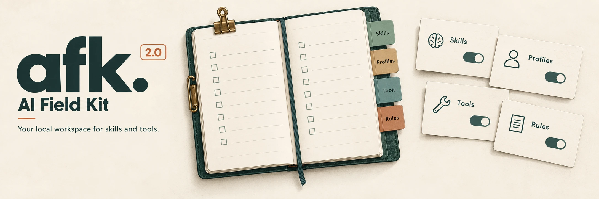

# AI Field Kit — AFK 2.0

> **Welcome to AFK 2.0.** This is the new, focused AFK. Want the previous setup,
> catalog, layered rules, hooks, or custom-agent behavior? Install a version before 2.0,
> or fork its tagged source from the [pre-2.0 releases](https://github.com/logbookfordevs/ai-field-kit/releases).

AFK is a local web workspace for the skills and tools you use with coding agents.
Keep a kit of skills that travels with you across machines, group the occasional
ones into packs, turn a pack on globally or for a project, and read a whole pack
on demand without turning it on.

AFK 2.0 is released. Unreleased changes in this checkout are listed under
**Next Release** in the [changelog](CHANGELOG.md).

## Run the local build

Requires Node.js 20 or newer and the repository's configured pnpm version.

```sh
pnpm install
pnpm afk:build
node packages/afk/dist/index.js
```

AFK opens a browser on a loopback address. Use **Exit AFK** in the header or
Ctrl+C in the terminal to stop it. Exiting preserves your configuration and
skill activation.

## What you can manage

| Section | Purpose | Scope |
| --- | --- | --- |
| Skills | Core, packs, this machine only, Try later and skills to review in one page; inspect, edit, update and delete skills and choose how agents invoke them | Global, or a selected project's own skills |
| Agent rules | Edit shared rules and references, preview and sync managed regions | Shared document; explicit destination files |
| Tools | Save and explicitly run install/update commands | Always global |
| Backup | Save your library to a private Git repository, go back to an earlier save, review edits made outside AFK | Your library |
| Settings | Your library, projects, agent folders and automatic updates | This machine |

Your skills, packs, tools, bookmarks, invocation choices and agent rules live in a
**library**: a Git repository at `~/.afk/library` where every change is one save.
Start one from the app (**Start a new library**) or with `afk library init --apply`.
**Backup** sends it to a private GitHub repository or any Git remote two minutes after
each change, and **Restore my library** (or `afk library connect owner/repo`) brings it
back on a new machine. See the [library guide](docs/kit.md).

The Skills page has five tabs. **Core** holds the skills saved in full in your library,
grouped by repository. **Packs** are named groups you turn on when needed. **This machine
only** keeps skills that stay here. **Try later** keeps repository bookmarks. **To review**
lists skills installed outside AFK so you can decide where they belong.

Install from a repository with **Install skills** or `afk add <repository>`, which asks
whether a skill belongs in Core, a pack, on this machine only or under Try later. You can
also upload a zip, a `.skill` file or a folder.

Packs prepare repository skills through Skills CLI in a private temporary
workspace and keep them in AFK's pack storage. Turning a pack on links them into your
agent folders; turning it off
removes only AFK-owned exposure. Existing files and skills needed by another pack are preserved.
A pack that is on can be edited without turning it off.

**Read once** shows a pack's instructions and a copyable command. AFK prints
the instructions for the calling agent to read; it does not inject another
chat or register a slash command.

Skill updates preserve on/off state and invocation choices. Skills that a tool
installs are labeled and update through the tool. Tools run saved commands
only when you choose Install or Update, individually or in a reviewed batch.
Removing a tool entry does not uninstall it.

Publishers can share a pack or Core with the [versioned manifest contract](docs/kit.md#share-a-pack-with-a-manifest)
and [example](docs/examples/skill-stack.v1.json). Import pasted JSON or a direct HTTPS
manifest URL, review it, then save it as a pack.

> **Breaking change:** settings are now version 2. Older AFK versions reject them, so
> update AFK on every machine that shares a settings file. Files that still hold
> stacks are not written until you run `afk migrate` or use the app's
> **Move to your kit** screen. See [Move to the kit](docs/kit.md#move-from-stacks).

## Manage AFK through your agent

The [afk-cli skill](skills/afk-cli/SKILL.md) gives agents the same management
capabilities as the app. It ships with AFK: run `afk guide` and have your agent read
the returned `SKILL.md` path. A separate skill installation is optional.
Edit simple definitions with schema guidance, run
`afk doctor --json` to check local consistency, and use headless AFK operations
for changes to skill files, activation links, and managed rule regions.
The [agent guide](docs/agents.md) explains installation and workflows.

## Documentation

- [App guide and CLI reference](packages/afk/README.md)
- [Managing AFK with an agent](docs/agents.md)
- [The kit: Core, packs and sync](docs/kit.md)
- [Settings, storage, and import/export](docs/settings.md)
- [Agent rules and conflict handling](docs/specs/agent-rules.md)
- [Development and verification](docs/development.md)
- [Product specification](docs/specs/afk-pivot.md)
- [Domain glossary](CONTEXT.md)
- [Changelog](CHANGELOG.md)

AFK no longer manages catalogs, conditional rule layers, hooks, MCP configuration, custom agents,
setup presets, or general agent-environment provisioning. Existing user files are not
automatically migrated or removed. Historical releases remain documented in the
changelog and Git history.

## Repository

- `packages/afk/src/fieldwork/`: CLI, settings, local APIs, skill preparation and activation.
- `packages/afk/web/`: local app and its scoped design system.
- `skills/afk-cli/`: agent management workflow and on-demand references.
- `docs/`: current guides, decisions, specifications, and approved design references.
- `apps/site/`: public website and documentation.
- `scripts/`: build, installation, and release support.

The live website is [ai-field-kit.logbookfordevs.com](https://ai-field-kit.logbookfordevs.com/).

AFK is a tool from [Logbook for Devs](https://logbookfordevs.com/).

## Update skills

Use **Update all** on the Skills page, or `afk skills update -g` /
`afk skills update -p <project>`, to update tracked skills while preserving
availability and AFK invocation preferences.

## Update AFK itself

Run `afk update` to rerun the hosted release installer and install the latest AFK
release. `afk update --dry-run` prints the command without running it. This is
separate from updating installed skills and works without reading AFK settings.

## Run in the background

```sh
afk --background
afk status
afk restart
afk stop
```

Background start prints the local URL without opening a browser. Status shows the
URL, process ID, resident memory (RSS) and log location. Stop gracefully closes the background instance;
foreground sessions are independent. Runtime records and logs stay under `~/.afk/`,
separate from your portable settings. Starting again reuses the running instance.
`afk ui --background` is also accepted. **Exit AFK** can close a background server
from the app; closing the browser tab leaves it running. Background instances use
the settings selected when they start. `afk restart` uses the running server’s
current port and settings path, even if your terminal’s `AFK_SETTINGS` changed.
If no background instance is running, it suggests `afk --background`. Foreground
sessions are untouched. To switch via `AFK_SETTINGS`, stop and start explicitly.

### Choose a fixed port

```sh
afk --port 4310
afk --background --port 4310
```

With `--port`, the app uses `http://127.0.0.1:4310`. Without it, AFK picks an
available port. Ports must be integers from 1 to 65535; an occupied port causes
an error rather than a fallback. Browser-blocked ports such as 6666 are rejected
before starting; choose a web port such as 4310 or 8080. If the background instance already uses another
port, run `afk stop` before restarting with your chosen port. The port is a launch
option, not a saved setting. `afk ui` accepts the same options.

`afk status` reports the server’s current resident RAM in MiB, including Node.js
and native allocations. It excludes the browser tab and child tool processes.
Older running servers show memory as unavailable until restarted after updating.
`afk restart` is included in the next release; use a source build until published.
